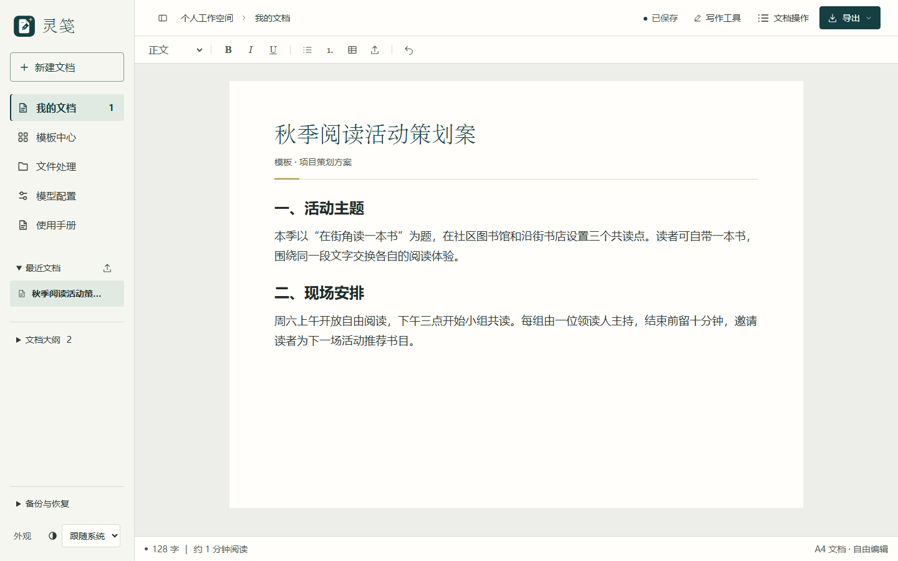

# 灵笺 · 文档工作台

现有 Word/PDF 的局部修改支持“原文定位 → 精确替换 → 修改核对 → 另存副本”。Word 可定位正文、表格、页眉页脚、文本框及脚注，保留未改文字的样式和其他文件部件；PDF 支持文字型文件的行内替换，保留页面尺寸、图片与矢量图形。重复匹配、快照失效、修改位置重叠和 PDF 新文字放不下时会拒绝保存并返回原因。模型按需自动调用内部技能，用户只需上传文件并描述修改要求，结果附修改前后摘要与下载入口。整页自动重排、数字签名文件修改仍不支持；文字变长可能影响 Word 分页，交付后仍需审阅。

工作台采用暖白纸面和深青色操作按钮，文档标题可在纸面上直接编辑。模板中心和文件库以目录行显示条目，支持深色和浅色外观。

支持用户自行配置 API 地址、密钥和模型 ID 的 AI 文档项目。默认采用单机模式：不登录，打开即用。需要用一台电脑供多人共用时，把 `LINGJIAN_AUTH_MODE` 改为 `accounts`，文档、文件和模型配置就会按账号隔离，密钥默认仅保留在当前登录会话内。当前阶段只面向本地运行，不提供服务器部署方案；账号、密钥与数据边界的说明见 [账号模式与本地数据安全](docs/local-security.md)。



## 快速开始

需要 **Node.js 22.23.5、24.22.3、26.13.1 或对应版本线的更高补丁版本**。从 GitHub 下载并解压源码，或克隆仓库，然后进入包含 `package.json` 的目录。

### 启动浏览器版

在项目目录运行下方命令，然后打开 [本地工作台](http://127.0.0.1:3210)。初次体验只需 Node.js，可以直接新建文档、浏览模板和导出 DOCX。使用 AI 写作时再[配置自己的模型](#配置自己的模型)。

```sh
npm run start:browser
```

可以用「会议纪要」模板试做一份文档。填入会议结论和行动项，在正文粘贴现场截图，再点击「导出 → Word 文档」，即可得到带图且可继续编辑的 DOCX。

### 启动桌面版

Windows 双击 **启动工作台.cmd**，脚本会在首次使用或 Electron 版本与锁文件不一致时安装依赖。也可在项目目录执行下方命令。

```sh
npm ci --include=dev
npm start
```

Electron 会打开独立窗口，并在本机启动后台（默认 `127.0.0.1:3210`）。关闭主窗口后会停止后台。桌面版与浏览器版共用项目的 `.data/` 目录，请先关闭其中一个再启动另一个。浏览器里未提交的恢复草稿可在原浏览器中导出备份。

直接处理现有 Office 文件或使用本地 OCR 时，可按需安装额外依赖。 [可选安装 Office 工具](#可选安装-office-工具)

可将 `.env.example` 复制为 `.env` 配置账号模式和端口，环境变量优先于文件。桌面版固定监听本机地址。端口被其他应用占用时，可将 `.env` 中的 `PORT` 改为可用端口再启动。

### 界面语言和英语写作

在侧栏底部或登录页的「界面语言」选择 **English**，即可切换界面和使用手册。切换前会保存当前文档，语言偏好保存在当前浏览器或桌面应用。

在「写作工具」展开「写作模型」，将「输出语言」设为「英语」，可用中文提示词生成英文正文、大纲或审阅结果。「自动」仍按写作要求选择语言。英文引用可用 `[Source: filename]`，现有的中文引用格式继续可用。文档和模板原文保留原语言。

### 需要多人共用时开启账号模式

在 `.env` 中设置 `LINGJIAN_AUTH_MODE=accounts` 并重启，登录页就会出现，此时文档、文件和模型配置按账号隔离，密码至少 12 个字符。账号模式下先用管理员配置加密主密钥，用户才能勾选「记住密钥」跨登录保存；其余差别见 [账号模式与本地数据安全](docs/local-security.md)。

升级前的 `.data/workspace.json` 和 `.data/office` 会原样保留：单机模式继续直接使用它们，账号模式不会自动交给首个注册者。要从单机数据迁到某个账号，先注册账号并停止服务，再执行 `node tools/migrate-workspace.mjs --username 你的用户名` 预览，确认数量后加 `--apply` 复制。工具保留旧数据、拒绝覆盖冲突内容，并支持重复执行。两种模式都禁止在未配置 `APP_ORIGIN` 的情况下对外监听；单机模式尤其只服务于当前这台电脑。

## 模板中心

内置 33 份模板：18 份中文模板（8 份写作框架、8 份中文文书、2 份中文 Excel），以及 15 份英文来源精选模板。新增工作通知、事项请示、工作情况报告、专题汇报、工作简报、专项工作方案、年度总结和会议讲话稿；通知、请示、情况报告和工作方案提供可编辑 DOCX，通知和方案另有 PDF 打印参考版。中文预算执行表与现金流预测表包含自动汇总、结余差额和月度余额结转公式。

默认显示中文模板，可按格式、语言、分类筛选或搜索；切换「全部语言」可查看整个模板库。详情提供填写方法、来源许可和本地下载。DOCX、XLSX、PDF、Markdown 支持一键加入文件库，自动选中副本并带入填写要求，补充需求后即可让模型处理。旧版 DOC / XLS 下载后需先另存为 DOCX / XLSX 再上传。英文原版均明确标注，中文改编和中文提纲另行说明。

所有文件随项目本地保存，使用时无需访问来源网站。来源、许可和维护说明见 [模板库说明](resources/templates/README.md)。

除内置模板外，还可以在模板中心点击「从范文提炼模板」，选择 1–5 篇自己写的文档，提炼章节顺序、常见表格列和固定术语，生成一份可编辑的私有模板。提炼是确定性的本地处理，不调用模型、不复制范文正文；保存前会显示章节与变量供核对，同类结构至少两份时更稳定。私有模板只保存在当前工作区，可随时删除，最多 30 份。

## 配置自己的模型

1. 打开左侧「模型配置」。
2. 在「模型服务商」中选择百炼、DeepSeek、Kimi、智谱或硅基流动，自动填写名称、地址、建议模型和输出预算；也可选择「自定义」手动填写，并选择接口协议。
3. 检查基础 API 地址与账号地域。地址始终可编辑，也接受完整的 `/chat/completions` 或 `/responses` 地址。
4. 通过「获取 API Key」进入对应平台，填写自己的 Key。在「选择模型」下拉框浏览全部预设；也可点击「从平台获取模型」查询平台当前返回的目录，或在模型 ID 输入框搜索、手动填写。本地无鉴权模型服务可不填 Key。
5. 点击「测试连接」，成功后点击「保存配置」。测试遵循高级设置中的流式输出选项，保留配置的推理输出预算；部分百炼思考模型须启用流式输出。测试会发送一条简短生成请求，可能产生服务商调用费用。
6. 返回「我的文档」，在右下方模型选择器中选择该配置。

支持 **OpenAI 兼容 Chat Completions** 和 **OpenAI Responses** 两种协议。兼容服务需要真正实现对应协议；Anthropic、Gemini 原生协议暂未适配。

内置预设均使用 Chat Completions，依据以下官方文档核对（2026-11-11）：

| 服务商 | 默认基础地址 | 默认模型 | 内置模型 ID 数 | 官方接入文档 |
| --- | --- | --- | --- | --- |
| 阿里云百炼 · 千问 | `https://dashscope.aliyuncs.com/compatible-mode/v1` | `qwen-plus` | 26 | [百炼 OpenAI 兼容](https://help.aliyun.com/zh/model-studio/compatibility-of-openai-with-dashscope) |
| DeepSeek | `https://api.deepseek.com` | `deepseek-flash` | 2 | [DeepSeek API](https://api-docs.deepseek.com/) |
| 月之暗面 · Kimi | `https://api.moonshot.cn/v1` | `kimi-k3.1-pro` | 6（其中 3 个限老账号） | [Kimi 快速开始](https://platform.kimi.com/docs/get-api-key) |
| 智谱 · GLM | `https://open.bigmodel.cn/api/paas/v4` | `glm-5.3` | 19 | [智谱 OpenAI 兼容](https://docs.bigmodel.cn/cn/guide/develop/openai/introduction) |
| 硅基流动 | `https://api.siliconflow.cn/v1` | `Qwen/Qwen3.5-4B` | 12 | [硅基流动 Chat API](https://docs.siliconflow.cn/docs/api/chat-completions-post) |

共 65 个服务商模型 ID，包含不同平台对同系列模型的独立部署。百炼覆盖 Qwen 3.5–3.8、Coder、VL 及部分第三方模型；智谱覆盖 GLM 4.x–5.x 的通用、Flash、编程与视觉型号；硅基流动覆盖 Qwen、DeepSeek、Kimi、GLM。目录依据 [百炼模型列表](https://help.aliyun.com/zh/model-studio/text-generation-model)、[智谱模型概览](https://docs.bigmodel.cn/cn/guide/start/model-overview)、[Kimi 模型列表](https://platform.kimi.com/docs/models)、[硅基流动接入示例](https://docs.siliconflow.cn/docs/usercases/use-siliconcloud-in-metis) 及 [模型上下线公告](https://docs.siliconflow.cn/docs/release-notes/overview) 核对，已排除明确停用及即将停用的硅基流动型号。

DeepSeek 官方当前主要提供 `deepseek-flash`、`deepseek-v4-pro` 两个有效型号；不加入已停用的 `deepseek-chat` / `deepseek-reasoner`。Kimi 的 `kimi-k2.7-code`、`kimi-k2.7-code-highspeed`、`kimi-k2.6` 仅供 2026-11-01 前注册账号继续使用，预计 2026-12 底全面下线，下拉选项已注明限制。

「从平台获取模型」使用当前 API 地址和填写的 Key（或本次服务已保存的 Key），请求由本机后端代理。标准兼容接口使用 `/models`；百炼按 [模型目录 API](https://help.aliyun.com/zh/model-studio/list-models) 使用 `/api/v1/models`，筛选文本生成并读取分页；硅基流动按 [模型列表 API](https://docs.siliconflow.cn/docs/api/models-get) 筛选 `sub_type=chat`。最多读取 20 页，超出时会提示；目录查询最长等待 30 秒。未实现模型列表接口的服务仍可使用内置列表或手填模型 ID。

平台查询结果只用于当前表单，不写入文档或模型配置。切换服务商、地址、协议或密钥时取消旧查询并恢复对应预设；获取失败会保留已有选择。模型目录可能包含需要另外开通的型号，列出模型不代表账号已拥有调用权限，仍需「测试连接」确认。

百炼默认使用北京地域仍受支持的公共域名，可改为控制台提供的业务空间专属域名。API Key 与地址必须属于同一地域；新加坡等地域需同时更换地址和密钥。建议模型仅用于快速配置，可用模型与权限以各平台控制台为准。

切换服务商会开始一份新配置，清空密钥输入框；已保存的配置仍保留。保存后可在模型列表中切换，继续编辑原配置时会恢复服务商与自定义的模型、地址、高级设置。旧版未记录服务商的配置按「自定义」加载。

DeepSeek、Kimi、GLM 等推理模型通常先思考再输出正文。预设为其提供较大的输出预算与超时；连接测试也使用配置的完整输出预算，避免思考 Token 占满 512 Token 导致误判。文件智能体会按 [DeepSeek 思考模式工具调用规范](https://api-docs.deepseek.com/guides/thinking_mode/) 回传 `reasoning_content`，正文只展示最终内容。

基础地址会直接追加路径，**不会擅自添加 `/v1`**。如果服务商给出的基础地址包含 `/v1`，请保留它。不同协议的完整地址不能混用。

高级设置支持最大输出 Token、超时、温度和流式开关。Chat 接口可选择 `max_tokens`、`max_completion_tokens` 或不发送输出长度参数；Responses 使用 `max_output_tokens`。对不接受温度参数的模型，请留空。接口实现依据 [OpenAI Chat Completions 官方文档](https://developers.openai.com/api/reference/resources/chat/subresources/completions/methods/create) 与 [Responses 流式事件官方文档](https://developers.openai.com/api/reference/resources/responses/streaming-events)。

## 编写流程

- 从「模板中心」选框架，或点击「新建文档」从空白开始。
- 直接编辑文档标题和正文。支持标题层级、加粗、斜体、下划线、列表、引用和基础表格。
- 「写作工具」中的「参考资料」支持 TXT、Markdown、CSV，以及 Word、Excel、PPT、PDF 的内容提取。文本文件兼容常见 UTF-8、UTF-16LE、GB18030 编码。勾选的资料才会进入 AI 任务。
- 在「AI 编写」中选择撰写全文、生成大纲、接着续写或审阅全文，并填写要求。
- 提交任务后可展开「工作过程」，实时查看带入的参考资料、加载的技能、提纲与起草步骤、文件操作和保存结果。每一步会保留完成、未完成或待核对状态，停止后也能回看已收到的记录。章节任务和文件处理同样有过程记录。刷新当前标签页后可查看最近一次任务。
- 需要 AI 修改局部时，先在正文中选中文字、图片或表格，再右键选择「AI 修改选区」。也可以按住右键拖选文字，松开时打开菜单。点击菜单项后，写作工具会显示「所选片段」卡片。表格与图片所在段落按完整块附加，卡片显示实际范围。
- 输入修改要求并发送后，结果会实时写入选区，保留前后文，并保存修改前的版本。手动更改正文导致选区失效时，需要重新选取并附加片段。
- 编辑器支持通过工具栏插入图片、粘贴截图和拖入 PNG/JPEG/WebP。插入前会压缩图片；单个原文件最多 10 MB，最长边缩至 1200 像素，正文仍受单篇 100 万字符限制。每次片段最多 4 张图片，所选图片会实际发送到当前模型，需要视觉输入能力。支持图片理解、说明和显示宽度调整；暂不重绘图片像素。Word 和 PDF 导出可保留图片，Markdown 和纯文本导出提取文字内容。
- 结果直接在中间正文实时显示，无需再次点击应用。全文撰写替换正文，续写追加到末尾，片段改写仅更新所选范围；生成时正文暂时只读。进度分批自动保存，停止或失败后标记未完成并保留已接收内容。工具栏「撤回 AI 修改」可整轮恢复原文，刷新后仍可用；如果后续还有手动编辑，先确认并保留当前历史版本后再撤回。每轮原文快照计入已有的 20 个历史版本上限。大纲与审阅结果在中间独立视图展示，可返回正文及复制；这两类报告暂不持久保存，原文不变。实际文件生成任务继续提供下载，不把工具摘要写入正文。
- 应用草稿和恢复版本前，自动保存原文快照；每篇文档保留最近 20 个历史版本。手动编辑会自动保存，`Ctrl+S` 可立即保存。有未保存修改或保存请求尚未完成时，关闭或刷新页面会请求浏览器提示确认；请以「已保存」状态为准。
- 导出 DOCX、Markdown、TXT 或 PDF。桌面版通过系统文件对话框保存 PDF，浏览器版通过打印预览保存。DOCX 保留可编辑的标题、文字格式、列表和表格，图片嵌入文件并按页面或单元格宽度等比缩放，无需安装 Microsoft Word。DOCX 导出每张表格最多 63 列，每篇文档最多 5 万个表格单元格和 100 张不同图片。
- 选中正文文字后点击「添加批注」。点击工具栏「批注」可定位原文、解决或重新打开批注。原文移动后仍可按文字定位，原文被删或无法判定是哪一处时，可选中新的文字并点击「改用当前选区」。批注保存在本地文档和备份中，适合自己跟踪待核对内容。

内置的 8 份中文写作框架包括项目策划方案、调研分析报告、工作总结与复盘、商业计划书、产品需求文档、会议纪要、制度与操作规范、项目申报材料，均含章节框架和专用写作规范。其余来源精选模板见上方「模板中心」说明。

选区修改会优先带入所选内容及可定位的邻近文字。要求引用或核对资料时，可在提示中说明或点名资料。正文起草和选区修改也可在「写作模型」里填写「资料检索词」，由本地检索挑出相关片段，点名的资料仍完整带入。没有命中时使用启用的资料，工作过程会显示取材方式。任务结果显示服务商回传的输入、输出及可用的缓存输入用量。

## 文档简报、依据台账与交付体检

这三项能力把「写之前、写之中、交付前」串起来，均以当前正文和本地资料为准，不联网。

### 文档简报

标题下方的「简报」记录写作目的、目标读者、范围与边界、关键事实、术语口径、交付约束和资料策略。保存后，每次写作任务都会把简报放进系统提示和上下文，AI 会按读者与范围调整内容；简报中未提供的数字、日期和结论必须标注「待补充」。简报只是任务约束，不会被当成事实证据，也不会计入引用核验。按钮上的百分比表示已填写项占 7 个检查项的比例，不评价内容质量。

### 依据台账

「依据」会把正文中带数字、引用标记或事实性表述的句子逐条列出，并与当前启用的资料原文比对，显示为以下状态：

- **已支持**：引用的资料中存在逐字或高度重合的原文。
- **待补引用**：找到可核对原文，但正文没有 `[资料：文件名]` 标记。
- **引用待核 / 仅少量重合**：有引用或少量词语重合，但未达到逐字依据标准。
- **无依据**：在所给资料中没有找到依据，数字会单独提示。
- **引用失效**：引用的资料不存在或已停用。

每条记录给出资料名、所在段落和原文引文，点击「定位正文」会回到对应位置并高亮。台账可整份复制，便于交付前会签。资料超过 12 万字符或启用超过 12 份时只比对可覆盖部分，并在检查说明中注明；它只证明「所给资料是否支持该说法」，不判断外部事实为真。

### 交付体检

「体检」汇总确定性检查并给出分级结论：

- 未补齐的占位内容（待补充、待确认、TODO 等）；
- 标题层级跳跃、重复章节、空章节、章节编号断档；
- 表格列数不一致、空单元格偏多；
- 引用指向不存在的资料、启用了资料但正文没有引用；
- 简报缺口与术语未在正文出现；
- 依据覆盖率、无依据说法、引用失效；
- 日期写法混用。

结论分为「需处理后交付」「建议确认后交付」「未发现阻断项」，并给出 0–100 分和必须处理、建议确认、提示三组问题。每项含位置与建议，能定位的直接跳回正文。结论只覆盖已执行的检查，不核对图片内容、外部事实、页面排版或 Office 公式；正文一旦修改，旧台账和体检结果会标记「过期」，需要重新检查。简报、台账与体检结果随文档保存在本地工作区，不额外发送给模型或第三方。

可把问题标记为「已确认」并筛选待处理项，刷新后继续查看。点击「重新检查」可看到仍存在、新增和已消失的问题。正文更新后，仍存在的问题会重新列为待处理。人工确认记录处理进度，体检结论和分数仍按实际发现计算。

界面验收截图存放在本地 `test-results/`（不随仓库发布）：`quality-1-editor.png`（工具栏入口）、`quality-2-brief.png`（简报）、`quality-3-evidence.png`（依据台账）、`quality-4-delivery.png`（体检）、`quality-5-distill.png` 与 `quality-6-distill-preview.png`（范文提炼）、`quality-7-my-templates.png`（我的模板）、`quality-8-dark.png`（深色主题）、`quality-9-mobile.png` 与 `quality-10-mobile-evidence.png`（窄屏 500px）。

## 章节工作台、任务队列与项目资料

标题下方的「章节」打开写作工作台，分为章节与队列、项目资料、批量审计、任务配方四个页签。四者都直接读写当前文档，不另存副本，也不改动未涉及章节的正文。

### 章节与任务队列

工作台按实际标题层级切章：有多个一级标题时按一级切分；只有一个一级标题时把它当作文档标题，改用二级。每章显示字数、段落、表格、引用、待补占位与小标题数量，并标出空章节和锁定状态。可以新增、上移、下移、删除章节，点击章节标题可定位正文；这些操作只重写涉及章节的切片，其余章节逐字节不变，并照常写入历史版本。

「锁定」用于保护已定稿章节：锁定后，针对该章的任务执行时会被拒绝并退回队列，不会写入正文；批量补全空章节会跳过锁定章节并说明跳过了几个。章节被删除或改名后，失效的锁与任务会一并清理，不会留下永远执行不了的队列项。

任务队列支持四类任务：补全或重写某一章、重写全文、核依据、交付体检。前两类会把该章（或全文）连同文档简报、模板规范与已启用资料发给当前模型，并明确要求只写目标章节；后两类是确定性检查，不调用模型。队列逐条执行，同一篇文档同时只允许一个任务运行；执行前自动保存，若生成期间正文被改动，结果不写入、任务退回队列，避免覆盖手动编辑。状态分为待执行、执行中、已完成、失败、已跳过，失败可重试；单篇最多 80 个任务，一次最多排 20 个。

### 项目知识空间

项目存放多篇文档共用的资料，一次维护、多篇引用。绑定到文档后，项目资料同时参与写作与依据核验，并与文档自有参考资料合并：自有资料在前、同文去重、按字符预算截断。检索是离线字面匹配（中文二元组加英文词），返回资料名、偏移与上下文片段，适合查具体数字、名称和术语，不是语义搜索。

一篇文档同时只绑定一个项目；解除绑定或删除项目都不会删除正文与文档自有资料。上限为 40 个项目、每个 30 份资料、单份 20 万字、单个项目 60 万字；项目资料仍保存在本地工作区，不额外上传。

### 批量审计

勾选最多 20 篇文档运行批量审计，逐篇执行与单篇「体检」完全相同的结构、占位符、引用与依据检查，再把正文字数、章节数、引用标记、依据覆盖、必须处理、建议确认和得分并列成一张对比表，并汇总多篇共有的问题与明显落后的文档。审计不修改任何文档，最近一次结果保存在工作区，刷新后仍可查看。

批量审计只并列指标，不做跨文档事实核对，也不判断两篇文档的结论是否冲突；口径与单篇体检一致，避免出现两套评分。

### 任务配方

配方把常用写作顺序存成步骤，一键排进当前文档的队列。内置「补全空缺章节」「全文起草后体检」「先核依据再体检」三份；也可以把当前队列（不含执行中的任务）存为私有配方。应用时按当前章节结构展开：空章节配方只排空章节，全部章节配方按全部展开，指定章节已不存在时跳过；一个配方最多 12 步，最多保存 20 份。

界面验收截图同样存放在本地 `test-results/`（不随仓库发布）：`studio-1-editor.png`（工具栏入口）、`studio-2-sections.png`（章节与队列）、`studio-3-task-modal.png`（排写作任务）、`studio-4-after-run.png`（执行完成）、`studio-5-projects.png` 与 `studio-5b-project-search.png`（项目资料与检索）、`studio-6-audit.png`（批量审计）、`studio-7-recipes.png`（任务配方）、`studio-8-dark.png`（深色主题）、`studio-9-mobile.png`（窄屏 500px，写作助手让位）。

## 自动任务处理

### 全文一致性检查

在「文件处理」勾选一份 DOCX、文字型 PDF、XLSX 或 PPTX，点击「全文一致性检查」。要求可留空，也可补充核对重点及明确口径，例如“金额统一以审批预算100万元为准”。平台先分页读取实际原文，再由当前配置模型比较金额与单位、日期、名称、术语和编号；不同项目、时间和统计口径的差异不应直接当作冲突。

每项问题列出至少两条可定位的原文证据、说明与核对建议。只有用户明确要求或文内明确基准能够支持统一口径时才提供修改建议；不明确哪个值正确时显示「待确认」，不会自动统一。证据、修改依据和目标须通过原文核验；接受的建议继续走原有快照、整批预检和另存副本流程。没有问题时显示“本次未发现可报告的前后冲突”，不保证无遗漏；结果质量仍取决于所选模型，本功能不核实外部事实。

报告显示实际读取范围。本次最多纳入 2000 个位置、约 11 万字符；单位置超过 6000 字符时原文会截取并提示不完整。Excel 底层最多扫描 10000 个已有单元格。检查 PDF 时，可勾选「识别 PDF 无文字页」，本机 OCR 一次最多补读 10 页，识别到的文字随检查发送给所选模型。报告标注 OCR 页码及每页最低识别置信度，涉及 OCR 的问题供人工对照原图确认。仅检查文字，不检查图像版式、演示备注或实际公式计算。报告和建议在当前服务内保留 30 分钟，刷新页面或服务重启后需重新检查。

### 修改建议操作

在文件库勾选一份 DOCX、文字型 PDF、XLSX 或 PPTX，输入修改要求，点击「生成修改建议」。AI 会定位实际原文，生成包含原文、新文、位置、上下文与理由的建议；整批建议通过快照、匹配、重叠及 PDF 空间预检后才展示。此阶段不会保存修订文件。

逐条勾选接受的修改，也可全选或全部拒绝，再点击「应用选中修改并另存」。后端只应用已核验的选中项，原件保留，结果提供修订版下载；Word 另执行结构检查。原文变化、建议冲突或 PDF 新文字放不下时拒绝保存整批修改。建议在当前服务内保留30分钟，每账号最多10批，刷新页面或服务重启后需重新生成；不提供 Word 修订标记或页面排版目检。

Word 正文普通段落另支持「在段前插入」「在段后插入」「删除段落」「拆分段落」建议。插入继承参考段落与首个文字片段样式，拆分保留粗体、斜体等各片段样式；拆分只在原文中增加一个段落边界，不同时改字。同一段落的结构修改不能与其他修改混用。含图片、域、已有修订、书签范围、编号或分节等内容的段落，以及表格、页眉页脚和文本框，暂不支持结构操作；复杂表格结构调整仍需后续增强。PDF 继续只支持行内文字替换。

Word 普通矩形表格支持按表格号、行号、列号定位，改写单段单元格（包括填写空白格），在参考行前后插入一行或删除指定行。行建议逐列展示原文、新文，插入继承参考行的列宽、行高及各单元格样式。行增删不能与同一行内部文字修改混用；合并单元格、嵌套表格、重复表头和含图片、域、已有修订或书签等内容的行受保护，不能删除最后一行。当前不增删列，不重算公式或汇总数据，条件样式、换行和分页仍需审阅。

Excel 可按工作表和单元格范围定位，改写文本、数字、布尔值或清空普通单元格，也可填写指定范围内的空白格。界面标明新值类型，保留原单元格格式、图表及文件其他部件。公式、合并区域、富文本、数据验证、链接、隐藏或受保护工作表只读；数字使用底层值，日期可能是序列号，不自动转换显示格式。修改后清除公式缓存并要求打开 Excel 重算，不在服务器计算汇总，也不增删行列。默认最多扫描10000个已有单元格，超过时提示不完整，需指定工作表和范围。仅支持 XLSX，宏、签名和旧 XLS 不支持此流程。

PPT 按实际幻灯片顺序、形状和段落定位，可精确替换普通文字片段，保留未改文字样式、图片、动画、母版及文件其他部件。域、链接与复杂段落受保护；不改备注、图片、图表或 SmartArt 内容。文字变长可能溢出或改变换行，需在 PowerPoint 中审阅，当前不自动调整字号或执行页面目检。仅支持 PPTX，签名和旧 PPT 不支持此流程。

用户输入需求并选择资料后，可在「工作过程」查看 Agent 实际加载的技能、读写的文件、生成的产物和交付检查状态。过程记录显示操作和文件名称，正文及文件产物仍在原有位置交付。

模型在任务开始时获得平台技能目录，可以主动调用内部 `use_skill` 加载并组合资料归纳、报告撰写、Word/PDF 精确修改、DOCX 交付检查。正式自动流程不以关键词规则选择技能；关键词判断仅保留在兼容辅助函数中。工具执行始终受平台文件范围与允许操作约束，加载技能不能授权读取其他文件、删除原件或执行任意脚本。

主写作入口也支持实际文件交付。例如输入“根据当前正文生成可下载的 Word 文件”，模型可以通过内部 `process_files` 将任务交给文件执行流程；正文和已启用资料随任务带入。生成的文件会显示在当前写作结果中，不会把文件完成说明替换进编辑器正文。选区修改、续写和审阅只处理对应内容，不开放文件移交。

普通草稿保留流式输出。模型加载报告技能后，全文报告会先准备提纲再起草正文；用量累计各阶段服务商返回的 Token 数据。多轮准备与工具执行可能增加模型请求，次数受平台限制。

所有选中文件必须有实际读取、检索或检查记录，才允许报告任务完成。输入文件默认只读，修改另存新文件。生成的 Word 自动执行结构、正文和占位符检查；检查后内容发生变化会重新检查。检查失败不会报告完成，需完善的信息会在结果中明确提示。

当前检查不执行 Word 页面排版目检，也不独立核实事实或计算。检查记录保留在本地文件库，用户界面隐藏内部 JSON 报告和调用日志。维护者可在 `skills/`、`lib/agent-skills.mjs` 与 `lib/office-agent.mjs` 中管理规则；兼容接口仍支持已有的内部技能参数，普通用户无需设置。

在文件库展开 DOCX，可点击「版式预览」。本机安装 LibreOffice 后，灵笺将临时副本转成 PDF，每次展示最多 4 页，可前后翻页核对分页、字体和表格。可通过环境变量 `LINGJIAN_SOFFICE_PATH` 指定 LibreOffice 可执行文件。预览反映 LibreOffice 的实际渲染，正式提交前可用收件人使用的阅读器核对。

## 本地资料检索与引用定位

资料检索由模型根据需求在后台调用，普通用户无需输入检索参数。例如输入“从这些资料找出项目预算，并在报告里标明出处”。检索支持 DOCX、PDF、XLSX/XLSM、PPTX、TXT、Markdown 和 CSV，返回原文片段及真实段落、表格行、页码、工作表单元格、幻灯片或文本行位置。

「资料归纳」和「报告撰写」技能也能调用 `search_sources`，智能体只能检索本次选中的文件和本次生成的 DOCX。搜索词以空格分隔时按任一词匹配；默认返回 12 个片段，可在工具参数里改为 1–50。未命中不代表相关事实不存在，检索结果不等于全文审阅。

每次最多 20 个文件，每份不超过 20 MB；单份最多扫描 10000 个片段、200 万字符，单片段最多检索前 10 万字符，超限会提示覆盖不完整。结果只在当前界面或任务上下文使用，不建立向量库，也不改原件。Word 检索正文段落及表格；Excel 公式按表达式检索，未重算；PDF 仅检索文本层，扫描件仍需要 OCR。该能力不进行联网检索。

自动验收使用实际 Word、Excel、PPT、PDF、TXT、Markdown、CSV 文件，核对返回位置、引用标记、数量限制、无匹配结果、原件字节保持和未选中文件隔离。

已完成浏览器验收：勾选测试资料、输入“预算”、发起检索，页面显示真实的第 2 行及 `[资料：检索验收.txt；行 2]` 引用标记。截图保存在本地 `test-results/source-search.jpg`（不随仓库发布）。

## 可选安装 Office 工具

灵笺通过本地 MCP stdio 连接单独安装的 [office-tool](https://github.com/xhj-cloud/office-tool)。请先核对第三方授权与自己的使用场景。可在项目目录执行以下命令，把核对过的上游版本装到默认位置。若已有本机集成，请直接使用其目录。 [第三方许可说明](docs/third-party.md)

```sh
git clone https://github.com/xhj-cloud/office-tool.git .vendor/office-tool
git -C .vendor/office-tool checkout --detach 45b3aec259a8f8805c8483fe6403e17b052d82be
```

需要 Python 3.10+。Windows 双击 **安装Office依赖.cmd**。Linux/macOS 运行 `python3 -m venv .venv-office && .venv-office/bin/python -m pip install -r requirements-office.txt`。在 `.env` 可设置 `OFFICE_TOOL_DIR` 指向包含 `server.py` 的可信本地安装。关闭工作台后可运行 `npm run doctor` 检查设置。打开 **Office 工具** 或点「重新连接」即可检测安装。

上游原版在灵笺中提供 Word 和 Excel 生成及文件库内的基础文件管理。精确修改、富格式导入、PPT/PDF 操作和 OCR 需要具备相应工具的兼容集成。下方是完整集成的功能说明。

打开左侧 **Office 工具**，可使用：

- **文件库**：上传 Word、Excel、PPT、PDF、文本、图片，单份最多 20 MB；下载已上传文件及生成产物。
- **读入编辑器 / 作为资料**：把现有文件内容转成新文档，或加入当前文档的参考资料。Word 按原文顺序读取标题、段落和表格，保留基础列表、引用和段内加粗、斜体、下划线、删除线与换行。复杂分页、合并或嵌套表格、图片和脚注适合在文件库中打开原件查看。Excel 默认读取第一个工作表，不重算公式；其他工作表可通过工具参数读取。扫描 PDF 的无文字页可自动使用服务器本地 OCR，单次最多 10 页；更长文件需分批识别，具体限制见下方「本地 OCR」。
- **内部执行能力**：包含 MCP 文件读写与修改预检操作，以及 DOCX 检查、资料检索，由模型在平台规则内调用。用户界面不展示工具注册表或 JSON 参数表单。
- **文件智能体**：勾选文件、输入任务，使用当前配置模型的原生工具调用执行实际文件操作；支持 Chat Completions 与 Responses。示例：“读取选中的报告，生成一份 Word 摘要”“根据当前正文生成 PPT”。模型必须支持 function/tool calling；图片目检还需要模型支持视觉。Chat 工具规划遵循流式设置，聚合完整参数后再执行；Responses 工具规划使用非流式 JSON。界面只显示任务和结果。

工具路径相对于文件库；上传后的实际文件 ID 会自动带入工具参数。工具不能访问 `.data/office/files` 之外的路径，嵌套图片/输出路径和符号链接也会检查。Office 编辑默认另存副本，覆盖或删除文件前复制到 `.data/office/backups`。智能体不开放删除、移动工具，手动工具目前只支持移动/删除单个文件。

**PDF 修改工具有会话状态**：替换、添加、高亮、遮盖等先改进程中的 PDF，需要再执行 **保存 PDF 修改 / pdf_save** 才会生成输出文件。文件智能体已包含这条执行规则。服务关闭或进程重置会丢弃尚未保存的 PDF 修改。

每次智能体任务最多 8 轮模型请求、16 次模型发起的工具调用；自动 DOCX 检查另计。可以停止后续步骤，已经执行并保存的文件操作会保留。工具结果过大时会明确标记截断；大文件请使用精简模式或拆分任务。

需要单独指定 Python 时，可在启动前设置 `OFFICE_PYTHON` 为完整解释器路径。所有依赖与调用均在本地进程，模型请求仍只发给你配置的 API。

## 响应速度与等待状态

润色、续写、大纲和审阅默认直接进入一次模型生成，不再先发起技能选择请求；显式指定的内部技能仍会加载对应规范。全文写作保留模型自主选择技能和文件交付能力，模型在选齐技能时可标记 `ready_for_writing`，加载成功后直接写作，省去独立的准备确认请求；准备出错或仍需后续步骤时继续正常规划。

报告仍先生成提纲再起草正文，提纲请求遵循当前流式设置，兼容仅流式模型。页面等待时显示阶段与已等待秒数，结束后显示首段响应与总耗时。这里的首段响应从点击生成开始计算，包含保存、任务准备及模型等待，不等同于厂商单次请求的首 Token 指标；没有收到正文时不显示首段响应数值。

这些优化减少程序发起的请求和不透明的等待，没有强制关闭模型思考或降低输出预算。实际耗时仍受所选模型、思考模式、输入长度和厂商负载影响。

## 字体与可读性

界面统一使用 `--font-sans`（中文优先：微软雅黑 → 苹方 → 思源黑体 → Segoe UI）。把中文字体排在拉丁字体之前，同一行里的汉字与数字会用同一套笔画，不会一半粗一半细。`--font-serif` 与 `--font-mono` 分别用于引文、封面预览和代码。

屏幕样式里不出现小于 13px 的中文：12px 的汉字横画不足一个像素，只能靠抗锯齿软化，看起来就是发虚。正文 18px / 行高 32px，标题 24 / 21 / 19px，行高取整数像素，避免基线落在半像素上。

标题字重从 500 改为 600。微软雅黑只有 Regular 与 Bold 两档，`font-weight:500` 会回落到 Regular，结果标题只靠字号区分、笔画和正文一样细。

次要文字从 `#616161` 调到 `#4f4f4f`（浅色主题对比度 6.2:1 → 8.2:1），深色主题从 `#aaaaaa` 调到 `#bdbdbd`（7.0:1 → 8.7:1）。占位符单独用 `--placeholder`，比次要文字更浅，避免和已填内容混淆。中文小标签（侧栏分组、面包屑上方的小字、面板眉标）去掉了正字距，拉开字距会让中文显得散。

`tests/typography.test.mjs` 固定了这四条：字号下限、字体族只用令牌且中文在前、两套主题的对比度、中文标签不带正字距。改样式时跑一次即可发现回退。

## 使用手册

侧栏「使用手册」是给不关心实现的人看的：按场景写，不按功能清单写。内容包括三分钟上手的五步、五个常见任务（从零写报告、一堆资料变成文档、改已有 Word、交稿前自查、几篇文档一起管）、按钮速查表、三条习惯、十条常见问题和一页边界说明。

它做在应用内（`#manual-view`），不另开页面：`public/` 的资源索引在启动时扫描一次，新增独立文件必须重启服务才能访问；应用内视图刷新即可，而且能自动跟随浅色/深色主题。

手册右上角有「打印这份手册」。点它会把折叠的问答先全部展开，打印完再恢复原状，`Ctrl + P` 也能用。打印样式只作用于 `body.manual-open`，不会影响正文「打印 / 保存为 PDF」的结果。A4 实测 7 页。

编辑页顶部「文档操作」集中提供文档简报、核对依据、交付检查、章节工作台和历史版本。「写作工具」打开撰写与资料面板，「导出」提供 Word、Markdown、纯文本和 PDF 选项。

## 连接失败排查

连接测试及 Chat 工具规划现在均遵循流式设置，避免“勾选流式但测试仍发送非流式请求”的兼容问题。工具参数分片会完整聚合后再执行，思考内容仅保留在模型上下文中。Responses 工具规划维持非流式 JSON，连接测试支持两种协议的流式及非流式响应。

测试失败时，页面显示具体原因，并可展开或复制「排查信息」：实际请求地址、模型 ID、请求模式、厂商 HTTP 状态、错误码与请求编号，不包含 API Key。

- HTTP 401：检查 Key、地域和计费方案是否与地址配套。百炼按量付费与 Coding Plan 使用不同地址；[官方 Base URL 总览](https://help.aliyun.com/zh/model-studio/base-url)。
- HTTP 403：根据厂商原文检查服务开通、模型权限或账号余额。
- HTTP 404：核对完整 API 路径和该地域可用的模型 ID，避免填写控制台或聊天网页地址。
- HTTP 400 提示 stream / enable_thinking：启用高级设置中的流式输出；[百炼错误说明](https://help.aliyun.com/zh/model-studio/error-code)。
- HTTP 429：根据原文区分额度不足和频率限制。DNS、网络权限、超时及证书问题会显示对应网络错误码。

可运行 `node tools/probe-provider-network.mjs` 检查五家预设的目录 GET 与对话 POST 是否可达。脚本不读取或发送密钥，不会触发已鉴权的模型生成；返回 HTTP 401 说明已到达厂商鉴权层，不代表账号鉴权成功。原始结果保存在本地 `test-results/provider-network-audit.json`（不随仓库发布）；[逐厂商复核范围与结果](tests/provider-audit.md) 区分真实网络探测、本地模拟回归及尚未执行的账号验证。

## 数据与密钥

默认的单机模式只有一个工作区，数据直接放在 `.data/`：当前正文在 `workspace.json`，历史快照在同目录 `history/<文档ID>.json`，文件库在 `office/`。不登录也就没有会话隔离，同一台电脑上任何能打开这个页面的人都能看到同样的文档——需要区分时请开启账号模式。

开启账号模式后，管理员专用的「管理端」支持用户搜索与分页、账号启停、会话/任务及文档/文件使用量统计、近期管理记录。停用会撤销会话，原有文档和文件保留。先注册账号、停止服务，再运行 `node tools/manage-admin.mjs --username 你的用户名 --apply` 设置管理员，重启并重新登录后使用。所有注册用户默认均为普通用户，未自动授权任何现有账号。设置预览、撤销及统计边界见 [管理端与管理员设置](docs/local-security.md#管理端与管理员设置)。

- 账号模式下，密码经独立随机盐与 scrypt 派生后保存在 `.data/accounts.json`。当前正文、资料和非敏感模型配置保存在 `.data/users/<用户ID>/workspace.json`，历史快照单独保存在同目录 `history/<文档ID>.json`，均以临时文件写入后替换。这样保存正文时不再重写全部历史；升级前的内联历史会在首次启动时自动拆分，主文件保留为 `workspace.json.v1.bak`。单机模式不使用 `users/`，直接沿用 `.data/workspace.json`。
- 同目录的 `meta.json` 只记录文档数、模型数与源文件大小/修改时间，供管理端统计直接读取，不解析整份工作区；导入预览的完整内容暂存在 `imports/<计划ID>.json`，应用后删除，最长保留 15 分钟。
- `workspace.json` 无法解析时不会卡住启动：原文件改名为 `workspace.json.corrupt-<时间戳>` 保留，工作区以空白文档继续，界面会提示备份位置。
- **API 密钥默认只在服务端内存中保存**，不写入工作区 JSON、浏览器存储或文档备份。单机模式在服务重启后清除；账号模式还会在退出、空闲 30 分钟或登录超过 8 小时后清除，同账号的其他登录会话也不会自动获得这些临时密钥。
- 账号模式下，管理员配置 `LINGJIAN_KEY_ENCRYPTION_KEY` 后，用户可主动勾选「记住密钥」，以 AES-256-GCM 加密保存在用户目录的 `keys.json`，绑定账号、配置 ID 和 API 来源；重新登录或服务重启仍可使用。界面支持立即清除全部会话中的对应密钥。主密钥由服务器环境或受保护的 `.env` 提供，不存入工作区。未配置主密钥时拒绝持久保存。单机模式不提供「记住密钥」，每次启动重新填写。
- 账号模式下，浏览器只持有 HttpOnly、SameSite=Strict 的随机登录 Cookie；公网 HTTPS 配置时还启用 Secure。接口校验会话、可信 Host/Origin 和独立 CSRF 令牌，并限制登录尝试、请求频率和并发任务。服务器不信任客户端的转发来源头。模型请求由服务器代理，错误日志不打印请求内容或密钥。单机模式没有登录 Cookie，但仍校验 Host/Origin 并校验 CSRF 令牌，防止其他网站提交请求。
- 执行 AI 任务时，当前正文、用户要求、选区和启用的资料会发送给当前配置的 API；普通编辑与模板操作不会调用模型。
- 左下角「备份全部文档」导出当前工作区的文档、资料与历史。模型配置、密钥和文件库需使用完整工作区备份。备份较大时按约 50 MB 分卷，单篇文档及其全部历史保存在同一卷，较大的单篇文档可以独占一卷。请下载所有分卷，再通过「导入文档备份」逐卷预览和确认。单份文件需小于 130 MB，工作区最多 200 篇文档。
- 导入接受版本 1 的灵笺 JSON，先显示标题、正文摘要、资料及历史数量，再选择同 ID 文档导入为副本（默认）、跳过或替换。不冲突的文档新增并保留 ID；同名但不同 ID 不视为冲突。损坏或超限的分卷整卷拒绝。恢复已达上限的备份时，可先清空目标工作区中的示例文档，或在已有工作区选择跳过或替换重复文档。
- 导入预览绑定当前会话，有效期 15 分钟；预览后任何文档变化均需重新预览。重复提交同一预览不会重复导入；重启或重新登录后需重新预览。工作区已有文档时，每卷导入前会写入 `restore-points/<快照ID>.json`（单机模式为 `.data/restore-points/`）。完成弹窗提供下载入口，较大的快照同样可以分卷下载。替换另保留「备份恢复前」正文历史；如需完整找回资料及历史，可重新导入恢复前备份。导入采用合并方式，不删除备份之外的现有文档。恢复快照不自动清理，维护时可先下载留存再手动归档。
- 编辑正文、标题及提交保存时，工作台保留按工作区和窗口区分的恢复草稿，AI 正文预览也会保留。保存失败时，可重试保存或下载草稿。服务重启后可在原页面重试，仍会检查原文档版本。版本冲突时，可从「恢复草稿」另存副本。恢复其他草稿时，当前未保存的编辑仍留在页面上。
- 恢复草稿保存在当前浏览器的站点数据中。空间不足时会尝试保存在当前标签页，关闭前请下载。两种存储都不可用时，草稿只留在页面内。账号模式下会话过期时，可在原页面重新登录同一账号找回草稿。确认保存后只清除本次保存的草稿，其他窗口更新的草稿仍保留。草稿未加密，只包含文档内容。
- 完整工作区备份适用于停服迁移或灾难恢复。它包含账号数据、文档、模型配置、文件库、修改备份、恢复快照和已有的加密密钥文件。项目的 `.env`、加密主密钥、登录会话及未写入服务端的浏览器草稿需分别处理。若要继续解密已记住的密钥，请单独保存并配置原加密主密钥。
- 停止工作台后，在项目目录运行以下命令。备份和恢复均需要新目录。恢复默认只显示内容分类、文件数和字节数并检查文件校验值，确认后再加 `--apply`。

```powershell
node tools/workspace-backup.mjs create ./workspace-backup
node tools/workspace-backup.mjs restore ./workspace-backup ./.data-restored
node tools/workspace-backup.mjs restore ./workspace-backup ./.data-restored --apply
```

要让现有工作台使用恢复结果，请停服，将原 `.data` 改名留存，再将 `.data-restored` 改名为 `.data` 后启动。
- 同账号多窗口保存和删除文档均采用版本检查；账号模式下不同账号的文档、文件和模型配置由独立工作区处理。旧单机数据不会由公开接口自动认领。

## 验证

```powershell
npm run check
npm test
```

修改文档处理功能后，运行 `npm run test:office`。固定样例位于 `tests/fixtures/office/`。编辑器导入单独验证提取与保存正文，原文件修改单独验证精确修改、另存和逐字节保护原件。需要更新固定样例时使用 `tests/fixtures/office_samples.py`。依赖缺失时请留意测试中的跳过提示。

可以重新请求模型生成建议。同一文件任务内重复调用相同写入会复用首次结果，写入结果不明时会停止后续写入并提示检查文件库。同一批审阅修改在有效期内重试相同勾选项会返回原修订副本。服务重启后旧建议失效，重新生成前请核对文件库中已保存的修订文件。

自动测试使用临时工作区和本地模拟模型服务，**不会调用真实付费 API**。Office 测试会真实启动 MCP 服务并生成、读取、编辑 Word/Excel/PPT/PDF 文件，还覆盖中文预览、编辑副本与原件字节校验、路径越界/链接防护、覆盖备份，以及两种模型协议的工具调用闭环。完整 Office 测试需要先安装 Python 依赖；未安装时会明确跳过这些测试。

技能测试覆盖自动/手动选择、相关工具范围、提纲与正文的两次真实请求、禁用资料排除、实际 DOCX 检查、检查报告保存、原件字节保持，以及“读取资料 → 生成 Word → 自动检查”的 Chat/Responses HTTP 流程。模型未经读取直接声称完成、空正文产物、检查后文件被改坏，均不能被报告为任务完成。四个 `SKILL.md` 已通过技能格式校验。

简报、模板提炼、依据台账与交付体检的测试覆盖：简报校验与提示词注入、跨范文章节合并与不复制正文、逐字依据与引用失效状态、数字缺失提示、占位符/空章节/表格列数/失效引用的分级结论，以及从创建文档、提炼保存模板、检查依据到删除模板后解除关联的完整接口闭环。

章节工作台、任务队列、项目资料、批量审计与配方的测试覆盖：按标题层级切章与键值稳定性、只替换目标章节且其他章节逐字节不变、移动与删除的边界行为；章节任务只把本章交给模型并明确只写本章、写回时剥掉重复标题、锁定章节与失效章节在执行前被拒绝、生成期间正文被改动时任务退回队列而不是卡在运行中；项目资料校验、同文去重、总量超限拒绝、字面检索命中与合并顺序；配方展开只排空章节、指定章节缺失时跳过、同一配方重放结果一致；以及从章节调整、锁定、排队、执行、跳过删除，到项目绑定后依据由「引用失效」变为「已支持」，再到批量审计与配方保存/应用的完整接口闭环。

自主处理版本另覆盖：模型真实调用 `use_skill` 组合技能、受限读取被拒后调整步骤、普通写作加载技能后流式输出，以及主写作入口调用 `process_files` 交付 Word。上述行为在 Chat 和 Responses 两种协议下均验证；测试模型为本地模拟接口，文件由实际工具生成。

排版约束由 `tests/typography.test.mjs` 覆盖：屏幕样式不出现小于 13px 的中文、字体族只使用 `--font-*` 令牌且中文排在拉丁字体之前、浅色与深色主题的次要文字对比度都达到 7:1、占位符比次要文字更浅、中文标签不带正字距。它直接读取 CSS 文本，不需要浏览器。

使用手册由 `tests/manual.test.mjs` 覆盖：手册是应用内视图且侧栏有入口、目录锚点都指向真实章节、手册里提到的九个按钮在页面上都有对应元素、打印规则只作用于手册而不会波及正文打印。手册最容易出的问题是与界面慢慢脱节，这组断言让按钮改名时先失败。

人工浏览器验收可使用隔离夹具：

```powershell
node tests/fixtures/ui-server.mjs
```

访问 `http://127.0.0.1:3211`。夹具已配置基础地址为 `http://127.0.0.1:3212/v1` 的模拟模型。该接口固定返回**模拟正文和工具调用指令**，但 Office 文件实际由 MCP 工具创建；只用于验收界面。正式工作台在 `3210`，不包含模拟配置。

浏览器验收覆盖：模型配置与连接测试、模板预览与建档、流式生成、应用正文、选区替换且其他章节保留、停止任务、资料上传、历史恢复、Word 下载；报告技能起草与应用、Word 生成后自动检查、手动选择 DOCX 检查技能、文件库直接检查；只填写一句话即生成可下载 Word 且不改写原文。桌面 1440px 与窄屏 390px 均无横向溢出，浏览器未记录脚本错误。验收使用隔离模拟模型与真实 Office 文件，截图与测试产物保存在本地 `test-results/`，不纳入版本控制。

使用手册的验收单独覆盖：侧栏进入后文档视图正确隐藏、面包屑为「使用手册」、六个目录锚点都能滚动到位、窄屏 500px 无横向溢出且卡片转单列、深色主题下正文与背景对比正常、打印导出 A4 共 7 页且侧栏与目录被隐藏、离开手册后页面状态正确恢复。截图见本地 `test-results/manual-1..6-*.png`，纸面样张见 `test-results/manual.pdf`（均不随仓库发布）。

## 当前边界

当前包括编辑器写作流程、共享任务技能的 Office 文件智能体和 DOCX 结构交付检查。普通写作结果审阅后应用，Office 任务会在文件库内执行工具。尚未实现联网检索、Word 页式渲染与完整导入、任意代码执行、团队协作和桌面安装包。

本版最多保存 200 篇文档、30 个模型配置；每篇最多 20 份资料，资料总量最多 50 万字符。单次 AI 上下文最多 15 万字符、生成结果最多 30 万字符。这些是应用字符上限，不保证模型的 Token 上下文能容纳，实际还需遵守服务商限制。基础编辑器暂不支持复杂 Word 布局、分节、脚注和嵌套列表的完整格式往返。

模板提炼只使用用户自己提供的文档，抽取章节、表格列和术语，不复刻版式或复制正文；每份模板 1–30 个章节，私有模板最多 30 份。依据台账按提取文本比对，DOCX/PDF 的「第 n 段」指提取文本中的段落，不等同于原文页码；不二次 OCR、不联网核验，也不判断外部事实为真。交付体检不修改文件，不检查导出后的 Word 页面排版；正文修改后旧结果需要重新检查。

章节工作台按标题标签切章，不解析分节符、脚注与复杂版式；只替换章节正文，不改表格列宽、图片位置或页面设置。锁只阻止队列写入，不阻止手动编辑；队列串行执行，不并行改写同一篇文档。批量审计最多 20 篇，只并列指标、不做跨文档事实核对。项目资料按字面匹配检索，中文同义改写可能查不到；项目上限 40 个、每个 30 份资料。

使用手册是手写的静态内容，不是从界面自动生成。按钮改名或新增入口时，手册正文与 `tests/manual.test.mjs` 里的按钮映射要一起改，否则测试先失败。手册的纸面版走浏览器打印，不含插图。

推荐后续顺序为操作系统凭据库与桌面封装、将版式预览扩展到其他格式、本地模型离线包。单机批注可跟踪个人核对事项，跨用户评论和 Word 批注导入导出仍待支持。

## 代码结构

```text
server.mjs              本机 HTTP 服务与接口
lib/providers.mjs       协议适配、SSE、超时与取消
lib/prompts.mjs         文档任务、资料上下文与简报注入
lib/document-brief.mjs  文档简报校验、缺口分析与提示词
lib/template-distill.mjs 从用户范文提炼章节、表格列与术语
lib/html-blocks.mjs     正文块、句子、标题编号的统一解析
lib/sections.mjs        章节切分、定位与只替换目标章节
lib/chapter-tasks.mjs   任务校验、章节写作范围与结果写回
lib/projects.mjs        项目资料、字面检索与资料合并
lib/batch-audit.mjs     跨文档批量审计与对比表
lib/recipes.mjs         任务配方的校验与按章节展开
public/studio.js        章节、队列、项目、审计与配方界面
lib/evidence.mjs        依据台账：说法抽取、逐字核验与定位
lib/delivery-check.mjs  交付体检：结构、占位符、引用与依据覆盖
public/quality.js       简报、台账、体检与范文提炼界面
lib/skills.mjs          维护技能定义与兼容辅助函数
lib/agent-skills.mjs    模型主动加载技能的受控运行时
lib/writing.mjs         技能写作与提纲/正文两阶段请求
lib/docx-inspection.mjs DOCX 检查调用、校验结果与报告保存
lib/source-search.mjs   本地资料检索、参数及路径检查
tools/search_sources.py 多格式文字检索与真实引用定位
skills/                四项任务技能及 DOCX 检查脚本
lib/store.mjs           工作区文件保存
lib/templates.mjs       专业框架与写作规范
lib/docx.mjs            标准 OOXML / ZIP 导出
public/                 无构建步骤的前端（使用手册为 #manual-view 视图）
lib/office*.mjs          MCP 客户端、路径边界、文件导入、模型工具调用
.vendor/office-tool/     单独安装的可选组件（本地目录）
requirements-office.txt Python 依赖与 MCP 兼容版本约束
requirements-office.lock 已验证的顶层依赖版本（供 doctor 比对）
tests/                  自动测试与隔离 UI 夹具
docs/                   安全说明、第三方许可、技术评审与文档用图
resources/templates/    内置模板、来源署名与各自许可
design/lingjian-logo/   品牌标识源文件
.github/                CI 工作流与 Issue / PR 模板
```

## 本地 OCR

已接入 RapidOCR 3.10.0 + ONNX Runtime CPU 中英文识别，无需 GPU 或 OCR API Key。「本地」指应用所在的这台电脑，识别在本机进程内完成。Windows 安装脚本会自动验证 OCR；手动验证时须使用 Office 虚拟环境的解释器：Windows 执行 `.venv-office\Scripts\python.exe tools/check-ocr.py`，Linux/macOS 执行 `.venv-office/bin/python tools/check-ocr.py`。

首次识别时按需下载模型，保留模型文件后可离线识别。识别结果不出本机，也不会上传到第三方 OCR 服务；识别后的文字在执行 AI 任务时仍会按所选模型发送。参数依据见 [RapidOCR 文档](https://rapidai.github.io/RapidOCRDocs/main/en/install_usage/rapidocr/usage/)。

文件处理上传 PNG/JPG/WebP 后点击“识别文字”或“作为资料”；扫描 PDF 的“读入编辑器”会自动对无文字页面 OCR，并保留已有文本页。模型可自动调用 `ocr_document`，支持页码范围、强制整页识别和行级置信度；一次最多 10 页，较长文档需分批，PDF 渲染每页最多约 1600 万像素。图文混排页面默认使用已有文字，若图片中的文字也要识别，需在任务要求中说明整页 OCR。

OCR 不会改写扫描原图、恢复复杂表格结构或自动生成可搜索 PDF，识别结果应核对姓名、金额和低置信度内容。

## 贡献

欢迎提交 Issue 和 Pull Request，流程与代码约定见 [CONTRIBUTING.md](CONTRIBUTING.md)，参与讨论请遵守 [贡献者行为准则](CODE_OF_CONDUCT.md)。当前阶段的项目范围是本地开发与运行，部署、容器编排、上线发布相关的改动暂不合并。安全问题请按 [SECURITY.md](SECURITY.md) 私下报告。

## 许可

本项目以 [MIT 许可](LICENSE) 发布。`resources/templates/` 中的第三方模板按各自许可分发，署名与许可见该目录 `README.md` 与 `*-LICENSE.txt`。

office-tool 由用户单独获取并管理，其授权见 [第三方组件与授权说明](docs/third-party.md#可选的-office-tool)。

## 致谢

- [office-tool](https://github.com/xhj-cloud/office-tool)：Word / Excel / PPT / PDF 处理的 MCP 工具。
- [RapidOCR](https://github.com/RapidAI/RapidOCR) 与 ONNX Runtime：本机中英文 OCR。
- 提供可再分发模板的机构与作者，逐项署名见 [模板库说明](resources/templates/README.md)。
