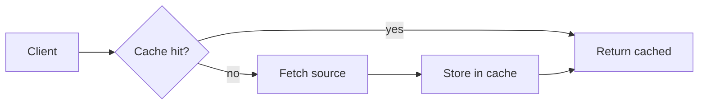

# Technical spec: Feature name

**Status:** Draft · **Author:** Your Name · **Last updated:** 2026-01-01

## Summary

One paragraph on the problem and the proposed solution.

## Goals and non-goals

- **Goal:** what this must achieve.
- **Non-goal:** what is explicitly out of scope.

## Design

Describe the approach here. The flow below is a [Mermaid](https://mermaid.js.org) diagram,
which renders as a real diagram in tools that support it.

## Data model

| Field | Type | Required | Notes |
|-------|------|----------|-------|
| `id` | string | yes | Primary key. |
| `created_at` | datetime | yes | UTC. |
| `payload` | object | no | Free-form metadata. |

## Performance target

The cache hit ratio $H$ over $n$ requests is:

$$H = \frac{\text{hits}}{\text{hits} + \text{misses}}$$

We aim for $H \ge 0.9$ at steady state.

## Rollout

1. Ship behind a flag.
2. Enable for 10% of traffic.
3. Measure, then ramp to 100%.

## Open questions

- Anything still undecided.

<!--
Source: https://github.com/Fokuus/markdown-templates
MIT License

Copyright (c) 2026 Anton Pycarelle (Fokuus)

Permission is hereby granted, free of charge, to any person obtaining a copy
of this software and associated documentation files (the "Software"), to deal
in the Software without restriction, including without limitation the rights
to use, copy, modify, merge, publish, distribute, sublicense, and/or sell
copies of the Software, and to permit persons to whom the Software is
furnished to do so, subject to the following conditions:

The above copyright notice and this permission notice shall be included in all
copies or substantial portions of the Software.

THE SOFTWARE IS PROVIDED "AS IS", WITHOUT WARRANTY OF ANY KIND, EXPRESS OR
IMPLIED, INCLUDING BUT NOT LIMITED TO THE WARRANTIES OF MERCHANTABILITY,
FITNESS FOR A PARTICULAR PURPOSE AND NONINFRINGEMENT. IN NO EVENT SHALL THE
AUTHORS OR COPYRIGHT HOLDERS BE LIABLE FOR ANY CLAIM, DAMAGES OR OTHER
LIABILITY, WHETHER IN AN ACTION OF CONTRACT, TORT OR OTHERWISE, ARISING FROM,
OUT OF OR IN CONNECTION WITH THE SOFTWARE OR THE USE OR OTHER DEALINGS IN THE
SOFTWARE.

-->
